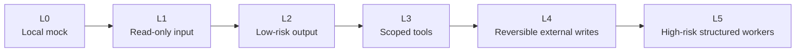
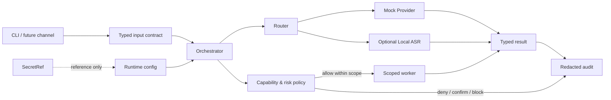
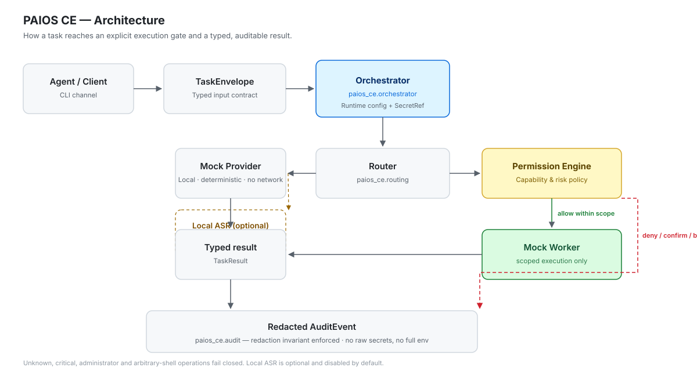
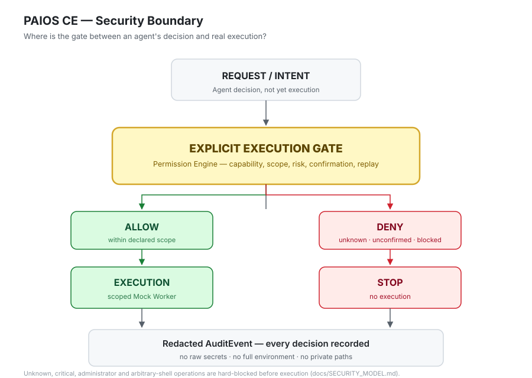

<div align="center">

# PAIOS CE

### Build a personal AI runtime one capability at a time

**Run a local task loop today. Add speech, channels, providers and workers only
when each capability has a typed contract, explicit permission and auditable
result.**

[](https://github.com/chengcheng-2006/paios-ce/actions/workflows/ci.yml)
[](https://github.com/chengcheng-2006/paios-ce/actions/workflows/package.yml)
[](https://github.com/chengcheng-2006/paios-ce/actions/workflows/security.yml)
[](https://github.com/chengcheng-2006/paios-ce/releases)
[](https://www.python.org/)
[](LICENSE)

[简体中文](README.zh-CN.md) ·
[Try it](#try-it-in-60-seconds) ·
[What works today](#what-works-today) ·
[How it grows](#how-paios-ce-grows) ·
[Documentation](#documentation)

</div>

> [!NOTE]
> The latest published source release is
> [`v0.1.0-rc.1`](https://github.com/chengcheng-2006/paios-ce/releases/tag/v0.1.0-rc.1).
> The `main` branch is the development line for the next candidate and may
> contain newer experimental capabilities.

---

## What can you do with it?

PAIOS CE is a small, runnable foundation for building a personal AI system
without starting from an unrestricted agent.

Today you can:

- run a deterministic local text-task loop with no API key;
- validate public and private configuration precedence;
- submit typed task and action fixtures through the CLI;
- observe permission decisions and redacted audit events;
- transcribe a local audio file through the optional Local ASR adapter
  **when using the current main development line or a later release**.

The point is not to expose every tool at once. The point is to provide a clean
path from a local demo to a useful personal assistant:

```text
local task loop
→ local speech input
→ one live Provider
→ one owner-only messaging channel
→ reversible tools
→ carefully scoped workers
```

Each step must remain explicit and independently testable.

## Try it in 60 seconds

```bash
git clone https://github.com/chengcheng-2006/paios-ce.git
cd paios-ce
python -m venv .venv
```

Windows PowerShell:

```powershell
.\.venv\Scripts\Activate.ps1
```

Ubuntu:

```bash
source .venv/bin/activate
```

Install and run:

```bash
python -m pip install --upgrade pip
pip install -e ".[dev]"

paios-ce health
paios-ce demo
paios-ce validate-config
paios-ce run-task examples/demo_task.json
```

No API key is required for the bundled Mock Provider.

### Blocked action

A request with an explicitly rejected unknown action is stopped before execution.
The demo shows `decision: blocked`, `execution_attempted: false`, and a blocked exit result.


### Local speech preview

On the current main development line, install the optional speech dependency:

```bash
pip install -e ".[dev,speech]"
```

Then transcribe an audio file using a local or cached model:

```bash
paios-ce transcribe sample.wav \
  --model tiny \
  --language en \
  --device cpu \
  --compute-type int8
```

Speech is disabled by default (`speech.enabled = false`). The default speech
path is local-files-only: a model identifier succeeds only when the model is
already cached locally. Model weights and audio files are not committed to the
repository.

## Two concrete workflows

### 1. Local text task

```text
CLI input
→ TaskEnvelope validation
→ Router
→ Mock Provider
→ TaskResult
→ redacted AuditEvent
```

### 2. Local audio transcription

```text
local audio file
→ audio policy validation
→ SPEECH_TRANSCRIBE_LOCAL capability check
→ FasterWhisperAdapter
→ typed TranscriptionResult
→ metadata-only AuditEvent
```

The transcript is returned to the requesting user. It is not written into the
audit event by default.

## What works today?

| Capability | Status | Default | What it means |
| --- | --- | --- | --- |
| Local text demo | Experimental | On | Deterministic Mock Provider; no network or API key |
| Typed tasks and actions | Experimental | On | Validated public contracts and JSON Schemas |
| Permission and risk decisions | Experimental | On | Unknown and forbidden actions fail closed |
| Secret references | Experimental | On | Secrets are represented by reference, not payload |
| Local file ASR | Experimental | Off | Optional faster-whisper adapter; no live channel; disabled by default |
| Live model Provider | Planned | Off | Not shipped |
| Feishu owner DM | Planned | Off | Next channel candidate; not shipped |
| WeCom / WeChat | Research | Off | No support claim |
| TTS | Planned | Off | Not shipped |
| Browser and system workers | Planned | Off | Must be narrowly scoped |
| Arbitrary shell / administrator | Blocked | Off | Not a general capability |

The authoritative status is maintained in
[`SUPPORT_MATRIX.md`](SUPPORT_MATRIX.md).

### Allowed action

A low-risk request within the granted scope is allowed to proceed.
The demo shows `decision: allow`, `risk_level: LOW`, and a successful exit result.


## How PAIOS CE grows

PAIOS CE uses **progressive capability admission**:



A new capability is not accepted merely because it works once. It must define:

1. a typed contract;
2. required capabilities and scopes;
3. default-off configuration;
4. secret and network behavior;
5. failure and rollback behavior;
6. redacted audit evidence;
7. deterministic tests;
8. clean-machine validation; and
9. an honest support status.

See [`docs/CAPABILITY_ADMISSION.md`](docs/CAPABILITY_ADMISSION.md).

## Architecture



### Request flow



## Product boundaries

The current project is a release candidate and a public-core scaffold. It does
not ship:

- live WeChat or Feishu channels;
- a production cloud-model Provider;
- microphone streaming;
- TTS;
- browser automation;
- arbitrary shell or administrator elevation;
- remote desktop control;
- production Hermes/OpenClaw integration.

Those are future adapters, not current support claims.

### The execution gate



Detailed trust boundaries live in
[`docs/SECURITY_MODEL.md`](docs/SECURITY_MODEL.md). The README keeps the safety
summary short so the runnable experience remains visible.

## CLI

| Command | Purpose |
| --- | --- |
| `paios-ce health` | Safe local diagnostics |
| `paios-ce demo` | Deterministic local text-task loop |
| `paios-ce validate-config` | Validate and display redacted effective configuration |
| `paios-ce run-task FILE` | Run a typed task or evaluate an action fixture |
| `paios-ce transcribe FILE` | Experimental local-file transcription (Phase 9A) |

## Validation

| Gate | Current baseline |
| --- | --- |
| Platforms | Windows + Ubuntu |
| Python | 3.11 + 3.12 |
| Existing test baseline | 298 passed + 1 filesystem skip |
| Line / branch coverage | 87.83% / 76.62% |
| Package | Wheel, sdist and clean-install smoke |
| Security | Credential scan, forbidden-content scan and dependency audit |
| Release | Public pre-release with anonymous source downloads |

Phase 9A preserves all existing gates and adds Local ASR-specific tests
without weakening coverage or workflow policy.

## Documentation

- [Getting started and demo](docs/DEMO.md)
- [Local ASR](docs/LOCAL_ASR.md)
- [Capability admission](docs/CAPABILITY_ADMISSION.md)
- [Architecture](docs/ARCHITECTURE.md)
- [Security model](docs/SECURITY_MODEL.md)
- [FAQ](docs/FAQ.md)
- [Roadmap](docs/ROADMAP.md)
- [Support matrix](SUPPORT_MATRIX.md)
- [Contributing](CONTRIBUTING.md)

## Community

- [Contributing](CONTRIBUTING.md)
- [Code of Conduct](CODE_OF_CONDUCT.md)
- [Security policy](SECURITY.md)
- [Support](SUPPORT.md)

## Next milestones

The recommended order is:

1. Local ASR (Phase 9A: contracts, policy, adapter, CLI, tests);
2. one real text Provider;
3. Feishu owner-only private messages;
4. local TTS;
5. a read-only file worker;
6. browser read-only research;
7. reversible, confirmed external actions;
8. structured Windows workers.

Personal WeChat and high-risk system permissions remain later research items.

## License

Apache License 2.0. Copyright 2026 Cheng Cheng.
