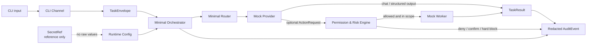

<div align="center">

# PAIOS CE

### A security-first, clean-room Python scaffold for privacy-preserving personal AI orchestration

**Local by default · Deny by default · Secrets by reference**

[](https://github.com/chengcheng-2006/paios-ce/actions/workflows/ci.yml)
[](https://github.com/chengcheng-2006/paios-ce/actions/workflows/package.yml)
[](https://github.com/chengcheng-2006/paios-ce/actions/workflows/security.yml)
[](https://github.com/chengcheng-2006/paios-ce/releases)
[](https://www.python.org/)
[](LICENSE)

[简体中文](README.zh-CN.md) ·
[Quick start](#quick-start) ·
[Architecture](#architecture) ·
[Security model](#security-model) ·
[Documentation](#documentation) ·
[Release](https://github.com/chengcheng-2006/paios-ce/releases/tag/v0.1.0-rc.1)

</div>

> [!IMPORTANT]
> **Current release: `v0.1.0-rc.1`**
>
> PAIOS CE is an experimental public-core scaffold, not a production personal
> assistant. The release candidate ships a deterministic local Mock Provider,
> a CLI, typed contracts, configuration and secret-reference abstractions,
> permission controls, redacted audit events, and safe diagnostics.
>
> It does **not** ship live model providers, live messaging channels, speech,
> browser automation, shell execution, remote execution, production databases,
> or production Hermes/OpenClaw integration.

---

## Why PAIOS CE?

A personal AI system may eventually connect models, tools, files, credentials,
channels, and automations. The difficult part is not only producing an answer.
It is controlling:

- what the system is allowed to do;
- which data may cross a boundary;
- how credentials are represented;
- how risky actions are denied or confirmed;
- how retries and replays are handled; and
- what redacted evidence remains afterward.

PAIOS CE makes those concerns explicit and testable. Instead of beginning with
broad tool access and attempting to add safety later, it begins with a small
public core and conservative defaults.

### Design principles

| Principle | Meaning in this release candidate |
| --- | --- |
| **Local by default** | The bundled Mock Provider is deterministic, offline, and requires no API key. |
| **Deny by default** | Workers begin with zero capabilities; actions must be explicitly allowed and scoped. |
| **Secrets by reference** | Configuration and protocols carry `SecretRef` identifiers, never raw secret values. |
| **Typed boundaries** | Tasks, actions, approvals, results, errors, and audit events are validated models. |
| **Fail closed** | Unknown, critical, administrative, and arbitrary-shell actions do not silently proceed. |
| **Redacted evidence** | Audit and diagnostic output is structured to avoid secret and private-path disclosure. |
| **Clean-room public core** | The published tree contains newly written public-core code and excludes production data and legacy source. |

## What is included?

| Area | Included in `v0.1.0-rc.1` | Status |
| --- | --- | --- |
| Configuration | Public, private, and runtime configuration models with strict precedence | Experimental |
| Secrets | `SecretRef`, `EnvSecretRef`, and `InMemorySecretRef` | Experimental |
| Protocols | Typed task, action, approval, result, error, and audit models plus JSON Schemas | Experimental |
| Permissions | Capability, scope, risk, confirmation, idempotency, and replay controls | Experimental |
| Provider | Deterministic local Mock Provider | Experimental |
| Channel | CLI entry point | Experimental |
| Worker | Mock Worker and worker contract | Scaffold |
| Routing | Minimal router that selects the bundled Mock Provider | Scaffold |
| Orchestration | Minimal local task/action loop | Scaffold |
| Audit | Structured JSONL audit events with mandatory redaction | Experimental |
| Health | Safe health checks and diagnostics | Experimental |

### Intentionally not shipped

The public release does not include:

- real cloud or local-model provider adapters;
- WeChat, Feishu, browser, or other live channels;
- speech, raw-audio storage, or cloud ASR;
- arbitrary shell execution or administrator elevation;
- remote execution or public-network binding;
- production databases, model weights, personal data, or real credentials;
- production Hermes or OpenClaw integration;
- internal audit packages, coverage databases, or validator archives.

The authoritative scope is defined by
[`SUPPORT_MATRIX.md`](SUPPORT_MATRIX.md) and
[`PUBLIC_RELEASE_BOUNDARY.md`](PUBLIC_RELEASE_BOUNDARY.md).

## Architecture



The current router targets only the bundled Mock Provider. Future adapters must
preserve the same protocol, `SecretRef`, permission, and audit boundaries.

A longer explanation is available in
[`docs/ARCHITECTURE.md`](docs/ARCHITECTURE.md).

## Security model

PAIOS CE uses conservative defaults for the public release candidate:

| Control | Default |
| --- | --- |
| Listener address | Loopback only: `127.0.0.1` |
| Public binding | Disabled |
| Group execution | Disabled |
| Owner allowlist | Required for owner-only actions |
| Worker capabilities | Empty / deny by default |
| High-risk actions | Explicit confirmation required |
| Critical actions | Hard-blocked |
| Arbitrary shell and admin elevation | Hard-blocked |
| Credential handling | `SecretRef` only |
| Raw audio storage | Disabled |
| Cloud ASR | Opt-in only |
| Bundled provider | Mock only; no network and no API key |
| Audit output | Structured and redacted |

> [!CAUTION]
> Do not report vulnerabilities through a public issue. Use GitHub private
> vulnerability reporting or Security Advisories as described in
> [`SECURITY.md`](SECURITY.md).

See [`docs/SECURITY_MODEL.md`](docs/SECURITY_MODEL.md) for the threat boundaries
and non-goals of this candidate.

## Quick start

### Requirements

- Python 3.11 or 3.12
- Windows or Ubuntu (validated); macOS or WSL may work but are not release-gated
- No API key for the bundled demo

### Clone and create an environment

```bash
git clone https://github.com/chengcheng-2006/paios-ce.git
cd paios-ce
python -m venv .venv
```

Activate the environment.

Windows PowerShell:

```powershell
.\.venv\Scripts\Activate.ps1
```

macOS, Linux, or WSL:

```bash
source .venv/bin/activate
```

Install the project for local development:

```bash
python -m pip install --upgrade pip
pip install -e ".[dev]"
```

Run the safe local checks:

```bash
paios-ce health
paios-ce demo
paios-ce validate-config
paios-ce run-task examples/demo_task.json
```

## CLI

| Command | Purpose |
| --- | --- |
| `paios-ce health` | Run safe local component diagnostics |
| `paios-ce demo` | Execute the deterministic local demo loop |
| `paios-ce validate-config` | Validate configuration and display the redacted effective configuration |
| `paios-ce run-task <file.json>` | Validate and run a task fixture or evaluate an action fixture |

The demo does not require a network connection, a provider credential, or a
real secret.

### Expected behavior

A normal local task can complete through the Mock Provider:

```text
CLI input
→ TaskEnvelope validation
→ permission/risk evaluation
→ Mock Provider
→ TaskResult
→ redacted AuditEvent
```

An unknown or forbidden action fails closed:

```text
ActionRequest
→ policy lookup
→ deny / hard block
→ execution_attempted = false
→ redacted AuditEvent
```

For reproducible command examples, see [`docs/DEMO.md`](docs/DEMO.md).

## Configuration precedence

PAIOS CE resolves configuration in this order:

```text
CLI flags
  → process environment
  → private local configuration
  → public project configuration
  → built-in safe defaults
```

Example configuration files:

- [`examples/public_config.example.yaml`](examples/public_config.example.yaml)
- [`examples/private_config.example.yaml`](examples/private_config.example.yaml)

Credentials are represented by `SecretRef`. The secret value itself must not be
serialized into public configuration, task payloads, logs, errors, or audit
events.

## Protocol boundaries

The public protocol layer provides validated models for:

- `TaskEnvelope`
- `ActionRequest`
- `ApprovalRequest`
- `ActionResult`
- `TaskResult`
- `ErrorEnvelope`
- `AuditEvent`

Generated JSON Schemas live in [`schemas/`](schemas/). Protocol models reject
unexpected fields, which helps prevent silent contract expansion.

## Validation

The release candidate is validated on Windows and Ubuntu with Python 3.11 and
3.12.

| Gate | Current result |
| --- | --- |
| Test matrix | Windows + Ubuntu × Python 3.11 + 3.12 |
| Test cases | 203 per matrix job |
| Failures / errors / skipped | 0 / 0 / 0 |
| Line coverage | 86.39% |
| Branch coverage | 73.50% |
| Package | Wheel and sdist build, metadata check, and clean-install smoke |
| Security | Secret-pattern scan, forbidden-content scan, workflow invariant check, and dependency audit |
| Release | Public pre-release with anonymously downloadable source ZIP and tar.gz |

The authoritative support claims are maintained in
[`SUPPORT_MATRIX.md`](SUPPORT_MATRIX.md).

## Project layout

```text
src/paios_ce/
├── audit/          redaction helpers and structured audit logger
├── channels/       channel contracts and CLI channel
├── cli/            command-line entry point
├── config/         public/private/runtime models and loader
├── demo/           deterministic local demo
├── health/         safe health and diagnostic checks
├── orchestrator/   minimal orchestration loop
├── permissions/    deny-by-default policy and risk engine
├── protocols/      typed task/action/result/audit contracts
├── providers/      Provider contract and Mock Provider
├── routing/        minimal router
├── secrets/        SecretRef abstractions
├── state/          state-adapter contract
├── tools/          schema helpers
└── workers/        Worker contract and Mock Worker

examples/           non-secret public fixtures
schemas/            generated JSON Schemas
tests/              unit, integration, and security tests
docs/               project documentation
```

## Documentation

- [Documentation index](docs/INDEX.md)
- [Architecture](docs/ARCHITECTURE.md)
- [Security model](docs/SECURITY_MODEL.md)
- [Demo guide](docs/DEMO.md)
- [FAQ](docs/FAQ.md)
- [Roadmap](docs/ROADMAP.md)
- [Security policy](SECURITY.md)
- [Support matrix](SUPPORT_MATRIX.md)
- [Public release boundary](PUBLIC_RELEASE_BOUNDARY.md)
- [Contributing guide](CONTRIBUTING.md)
- [Changelog](CHANGELOG.md)
- [Citation metadata](CITATION.cff)

## Roadmap

Near-term work remains deliberately incremental:

1. improve documentation and contributor ergonomics;
2. strengthen public protocol examples and contract tests;
3. define adapter acceptance gates before adding any live integration;
4. add integrations only when their permission, secret, audit, and rollback
   boundaries are independently testable.

A roadmap item is not a support claim. See [`docs/ROADMAP.md`](docs/ROADMAP.md).

## Contributing

Bug reports, documentation corrections, tests, and narrowly scoped pull
requests are welcome.

Before contributing:

1. read [`CONTRIBUTING.md`](CONTRIBUTING.md);
2. follow [`CODE_OF_CONDUCT.md`](CODE_OF_CONDUCT.md);
3. never submit real secrets, personal data, production paths, or production
   logs;
4. include tests for behavior changes; and
5. discuss live integrations before implementation.

## Release

The current public pre-release is
[`v0.1.0-rc.1`](https://github.com/chengcheng-2006/paios-ce/releases/tag/v0.1.0-rc.1).

It is a release candidate and makes no claim of production readiness, SLA, or
fitness for a particular deployment.

## License

Apache License 2.0. Copyright 2026 Cheng Cheng.

See [`LICENSE`](LICENSE), [`NOTICE`](NOTICE), and
[`THIRD_PARTY_NOTICES.md`](THIRD_PARTY_NOTICES.md).
