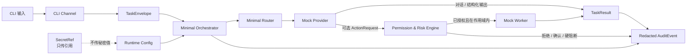

<div align="center">

# PAIOS CE

### 一个安全优先、洁净室实现、面向隐私保护个人 AI 编排的 Python 公共核心脚手架

**默认本地 · 默认拒绝 · 凭据只传引用**

[](https://github.com/chengcheng-2006/paios-ce/actions/workflows/ci.yml)
[](https://github.com/chengcheng-2006/paios-ce/actions/workflows/package.yml)
[](https://github.com/chengcheng-2006/paios-ce/actions/workflows/security.yml)
[](https://github.com/chengcheng-2006/paios-ce/releases)
[](https://www.python.org/)
[](LICENSE)

[English](README.md) ·
[快速开始](#快速开始) ·
[架构](#架构) ·
[安全模型](#安全模型) ·
[文档](#文档) ·
[当前版本](https://github.com/chengcheng-2006/paios-ce/releases/tag/v0.1.0-rc.1)

</div>

> [!IMPORTANT]
> **当前版本：`v0.1.0-rc.1`**
>
> PAIOS CE 当前是实验性的公共核心脚手架，不是可以直接投入生产的个人 AI
> 助手。本候选版本提供确定性的本地 Mock Provider、CLI、类型化协议、配置与
> SecretRef 抽象、权限控制、脱敏审计事件和安全诊断。
>
> 当前不包含真实模型 Provider、真实消息渠道、语音、浏览器自动化、Shell
> 执行、远程执行、生产数据库，也不包含生产版 Hermes/OpenClaw 集成。

---

## 为什么做 PAIOS CE？

个人 AI 系统未来可能连接模型、工具、本地文件、凭据、消息渠道和自动化任务。
真正困难的不只是“让模型回答”，而是明确控制：

- 系统允许做什么；
- 哪些数据可以跨越边界；
- 凭据以什么形式被引用；
- 高风险操作如何拒绝或确认；
- 重试和重放如何处理；
- 事后保留什么经过脱敏的证据。

PAIOS CE 不从“给 Agent 尽可能多的权限”开始，而是先构建一个范围小、可测试、
默认保守的公共核心。

### 设计原则

| 原则 | 在当前候选版本中的含义 |
| --- | --- |
| **默认本地** | 内置 Mock Provider 确定性、本地运行，不需要 API Key。 |
| **默认拒绝** | Worker 初始能力为空，Action 必须显式授权并限定作用域。 |
| **凭据只传引用** | 配置和协议只携带 `SecretRef`，不携带秘密值。 |
| **类型化边界** | Task、Action、Approval、Result、Error、Audit 都是校验模型。 |
| **失败关闭** | 未知、关键、管理员和任意 Shell 操作不会静默执行。 |
| **脱敏证据** | 审计和诊断输出避免泄露秘密值和私人路径。 |
| **洁净室公共核心** | 公开树只包含新写公共核心，不包含生产数据和旧实现源码。 |

## 当前包含什么？

| 模块 | `v0.1.0-rc.1` 中的内容 | 状态 |
| --- | --- | --- |
| 配置 | Public、Private、Runtime 配置模型和严格优先级 | Experimental |
| 凭据 | `SecretRef`、`EnvSecretRef`、`InMemorySecretRef` | Experimental |
| 协议 | Task、Action、Approval、Result、Error、Audit 类型模型及 JSON Schema | Experimental |
| 权限 | 能力、作用域、风险、确认、幂等和重放规则 | Experimental |
| Provider | 确定性本地 Mock Provider | Experimental |
| Channel | CLI | Experimental |
| Worker | Mock Worker 和 Worker 合同 | Scaffold |
| 路由 | 只选择内置 Mock Provider 的最小路由器 | Scaffold |
| 编排 | 最小本地 Task/Action 闭环 | Scaffold |
| 审计 | 强制脱敏的结构化 JSONL 事件 | Experimental |
| 健康检查 | 不泄露秘密和私人路径的安全诊断 | Experimental |

### 明确不包含

当前公开版本不包含：

- 真实云端或本地模型 Provider；
- 微信、飞书、浏览器等真实渠道；
- 语音、原始音频存储和云端 ASR；
- 任意 Shell 和管理员提权；
- 远程执行和公网绑定；
- 生产数据库、模型权重、个人数据和真实凭据；
- 生产版 Hermes 或 OpenClaw 集成；
- 内部审计包、覆盖率数据库和 Validator 归档。

权威范围以 [`SUPPORT_MATRIX.md`](SUPPORT_MATRIX.md) 和
[`PUBLIC_RELEASE_BOUNDARY.md`](PUBLIC_RELEASE_BOUNDARY.md) 为准。

## 架构



当前路由器只指向内置 Mock Provider。未来适配器也必须保持相同的协议、
`SecretRef`、权限和审计边界。

更完整的说明见 [`docs/ARCHITECTURE.md`](docs/ARCHITECTURE.md)。

## 安全模型

| 控制项 | 默认值 |
| --- | --- |
| 监听地址 | 仅回环地址 `127.0.0.1` |
| 公网绑定 | 关闭 |
| 群组执行 | 关闭 |
| Owner allowlist | Owner-only 操作必须启用 |
| Worker 能力 | 空集合 / 默认拒绝 |
| 高风险操作 | 必须明确确认 |
| Critical 操作 | 硬阻断 |
| 任意 Shell 和管理员提权 | 硬阻断 |
| 凭据处理 | 仅 `SecretRef` |
| 原始音频存储 | 关闭 |
| 云端 ASR | 仅主动选择 |
| 内置 Provider | 仅 Mock，不联网、不需要 API Key |
| 审计输出 | 结构化并脱敏 |

> [!CAUTION]
> 安全漏洞不要通过公开 Issue 报告。请按照 [`SECURITY.md`](SECURITY.md)
> 使用 GitHub 私有漏洞报告或 Security Advisories。

## 快速开始

要求：

- Python 3.11 或 3.12；
- Windows 或 Ubuntu（已验证）；macOS 或 WSL 可尝试但不在发布门禁内；
- 内置演示不需要 API Key。

```bash
git clone https://github.com/chengcheng-2006/paios-ce.git
cd paios-ce
python -m venv .venv
```

Windows PowerShell：

```powershell
.\.venv\Scripts\Activate.ps1
```

macOS、Linux 或 WSL：

```bash
source .venv/bin/activate
```

安装并运行：

```bash
python -m pip install --upgrade pip
pip install -e ".[dev]"

paios-ce health
paios-ce demo
paios-ce validate-config
paios-ce run-task examples/demo_task.json
```

## CLI

| 命令 | 用途 |
| --- | --- |
| `paios-ce health` | 执行安全的本地组件诊断 |
| `paios-ce demo` | 运行确定性的本地闭环 |
| `paios-ce validate-config` | 校验配置并显示脱敏后的有效配置 |
| `paios-ce run-task <file.json>` | 校验并运行任务 fixture，或评估 Action fixture |

演示不需要网络连接、Provider 凭据或真实秘密。

未知或禁止的 Action 会失败关闭：

```text
ActionRequest
→ 权限规则查找
→ 拒绝 / 硬阻断
→ execution_attempted = false
→ 脱敏 AuditEvent
```

## 配置优先级

```text
CLI 参数
  → 进程环境变量
  → 私有本地配置
  → 公共项目配置
  → 内置安全默认值
```

示例配置：

- [`examples/public_config.example.yaml`](examples/public_config.example.yaml)
- [`examples/private_config.example.yaml`](examples/private_config.example.yaml)

配置和协议只保存 `SecretRef`，秘密值本身不得进入公共配置、Task、日志、错误或审计事件。

## 验证状态

| 门禁 | 当前结果 |
| --- | --- |
| 测试矩阵 | Windows + Ubuntu × Python 3.11 + 3.12 |
| 测试用例 | 每个矩阵任务 203 项 |
| 失败 / 错误 / 跳过 | 0 / 0 / 0 |
| 行覆盖率 | 86.39% |
| 分支覆盖率 | 73.50% |
| 构建 | Wheel、sdist、元数据检查和干净安装冒烟 |
| 安全 | 凭据模式扫描、禁止内容扫描、工作流不变量和依赖审计 |
| Release | 公开 Pre-release，源码 ZIP 和 tar.gz 可匿名下载 |

权威支持声明见 [`SUPPORT_MATRIX.md`](SUPPORT_MATRIX.md)。

## 文档

- [文档索引](docs/INDEX.md)
- [架构](docs/ARCHITECTURE.md)
- [安全模型](docs/SECURITY_MODEL.md)
- [演示指南](docs/DEMO.md)
- [常见问题](docs/FAQ.md)
- [路线图](docs/ROADMAP.md)
- [安全策略](SECURITY.md)
- [支持矩阵](SUPPORT_MATRIX.md)
- [公开发布边界](PUBLIC_RELEASE_BOUNDARY.md)
- [贡献指南](CONTRIBUTING.md)
- [变更记录](CHANGELOG.md)
- [引用信息](CITATION.cff)

## 路线图

近期工作保持小步推进：

1. 改进文档和贡献者体验；
2. 增强公共协议示例与合同测试；
3. 在加入真实适配器前先冻结验收门禁；
4. 只有当权限、SecretRef、审计和回滚边界都可以独立验证时，才加入集成。

路线图不等于支持声明。详情见 [`docs/ROADMAP.md`](docs/ROADMAP.md)。

## 贡献

欢迎提交 Bug、文档修正、测试和范围明确的 Pull Request。

提交前：

1. 阅读 [`CONTRIBUTING.md`](CONTRIBUTING.md)；
2. 遵守 [`CODE_OF_CONDUCT.md`](CODE_OF_CONDUCT.md)；
3. 不得提交真实秘密、个人数据、生产路径或生产日志；
4. 行为变化必须提供测试；
5. 新增真实集成前必须先讨论架构和安全边界。

## 当前版本

公开 Pre-release：
[`v0.1.0-rc.1`](https://github.com/chengcheng-2006/paios-ce/releases/tag/v0.1.0-rc.1)。

它是候选版本，不承诺生产就绪、SLA 或适用于特定部署。

## 许可证

Apache License 2.0。Copyright 2026 Cheng Cheng。

参见 [`LICENSE`](LICENSE)、[`NOTICE`](NOTICE) 和
[`THIRD_PARTY_NOTICES.md`](THIRD_PARTY_NOTICES.md)。
