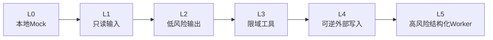
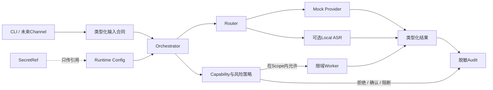
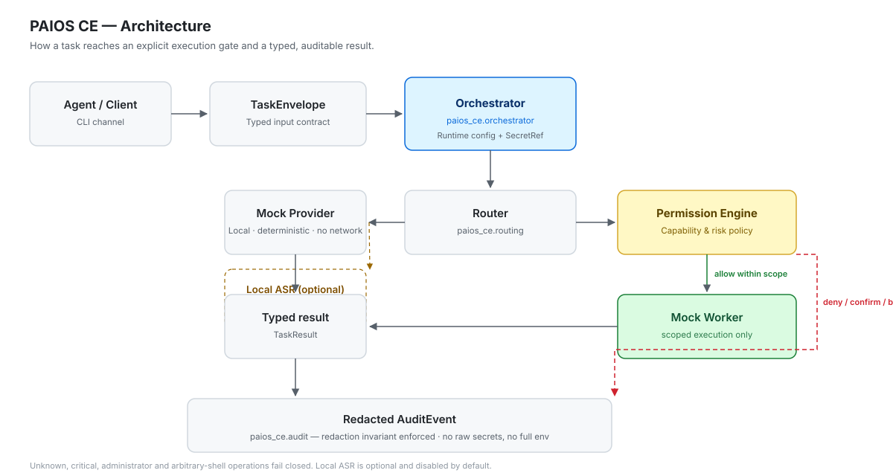
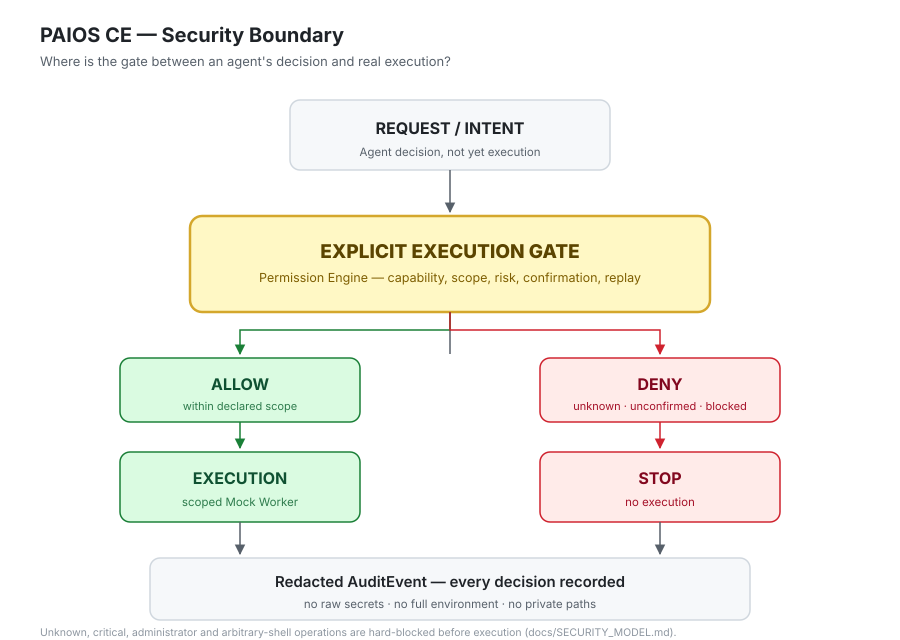

<div align="center">

# PAIOS CE

### 一次只开放一项能力，逐步构建个人 AI Runtime

**今天先运行本地任务闭环。以后再加入语音、渠道、模型和 Worker——但每一项能力都
必须有类型化合同、明确权限和可审计结果。**

[](https://github.com/chengcheng-2006/paios-ce/actions/workflows/ci.yml)
[](https://github.com/chengcheng-2006/paios-ce/actions/workflows/package.yml)
[](https://github.com/chengcheng-2006/paios-ce/actions/workflows/security.yml)
[](https://github.com/chengcheng-2006/paios-ce/releases)
[](https://www.python.org/)
[](LICENSE)

[English](README.md) ·
[60秒运行](#60秒运行) ·
[今天能做什么](#今天能做什么) ·
[如何逐步成长](#paios-ce-如何逐步成长) ·
[文档](#文档)

</div>

> [!NOTE]
> 当前已发布版本仍为
> [`v0.1.0-rc.1`](https://github.com/chengcheng-2006/paios-ce/releases/tag/v0.1.0-rc.1)。
> `main` 是下一个候选版本的开发线，可能包含更新的实验能力。

---

## 它现在能帮你做什么？

PAIOS CE 是一个可以实际运行的小型底座，用来逐步构建个人 AI 系统，而不是一开始
就给 Agent 开放全部工具和权限。

今天你可以：

- 在本地运行一个不需要 API Key 的文本任务闭环；
- 校验公共配置、私有配置和环境变量优先级；
- 通过 CLI 提交类型化 Task 与 Action；
- 观察权限决策和经过脱敏的 AuditEvent；
- 在当前 main 开发线或之后的版本中，通过可选 Local ASR Adapter 转录本地音频文件。

它的产品路线是：

```text
本地文本任务
→ 本地语音输入
→ 一个真实模型 Provider
→ 一个 Owner-only 消息渠道
→ 可逆工具
→ 严格限权的 Worker
```

不是一次性打开全部能力，而是一项一项验收后加入。

## 60秒运行

```bash
git clone https://github.com/chengcheng-2006/paios-ce.git
cd paios-ce
python -m venv .venv
```

Windows PowerShell：

```powershell
.\.venv\Scripts\Activate.ps1
```

Ubuntu：

```bash
source .venv/bin/activate
```

安装并运行：

```bash
python -m pip install --upgrade pip
pip install -e ".[dev]"

paios-ce health
paios-ce demo
paios-ce validate-config
paios-ce run-task examples/demo_task.json
```

内置 Mock Provider 不需要联网和 API Key。

### 本地语音识别预览

在当前 main 开发线上，安装可选语音依赖：

```bash
pip install -e ".[dev,speech]"
```

使用本地或已缓存模型转录音频：

```bash
paios-ce transcribe sample.wav \
  --model tiny \
  --language zh \
  --device cpu \
  --compute-type int8
```

语音能力默认关闭（`speech.enabled = false`）。默认使用 local-files-only：只有
模型已在本地缓存时才可用。模型权重和音频文件不会被提交进仓库。

## 两个具体工作流

### 1. 本地文本任务

```text
CLI输入
→ TaskEnvelope校验
→ Router
→ Mock Provider
→ TaskResult
→ 脱敏AuditEvent
```

### 2. 本地音频转录

```text
本地音频文件
→ 音频输入策略校验
→ SPEECH_TRANSCRIBE_LOCAL能力检查
→ FasterWhisperAdapter
→ 类型化TranscriptionResult
→ 仅元数据AuditEvent
```

转录文本只返回给当前调用者，默认不写入审计事件。

## 今天能做什么？

| 能力 | 状态 | 默认 | 当前含义 |
| --- | --- | --- | --- |
| 本地文本Demo | Experimental | 开启 | 确定性Mock Provider，不联网、不需要Key |
| 类型化Task与Action | Experimental | 开启 | 公共合同和JSON Schema |
| 权限与风险决策 | Experimental | 开启 | 未知或禁止动作失败关闭 |
| SecretRef | Experimental | 开启 | 传递引用，不把秘密放进Payload |
| 本地文件ASR | Experimental | 关闭 | 可选faster-whisper，不包含真实渠道，默认关闭 |
| 真实模型Provider | Planned | 关闭 | 尚未发布 |
| 飞书Owner私聊 | Planned | 关闭 | 下一渠道候选，尚未发布 |
| 企业微信/个人微信 | Research | 关闭 | 当前不做支持声明 |
| TTS | Planned | 关闭 | 尚未发布 |
| 浏览器与系统Worker | Planned | 关闭 | 必须严格限权 |
| 任意Shell/管理员权限 | Blocked | 关闭 | 不作为通用能力 |

权威状态见 [`SUPPORT_MATRIX.md`](SUPPORT_MATRIX.md)。

## PAIOS CE 如何逐步成长



一项能力只有满足以下条件才允许进入：

1. 类型化合同；
2. 明确Capability和Scope；
3. 默认关闭；
4. 明确Secret与网络行为；
5. 明确失败和回滚；
6. 脱敏审计；
7. 确定性测试；
8. 干净机器验证；
9. 真实、克制的支持状态。

详见 [`docs/CAPABILITY_ADMISSION.md`](docs/CAPABILITY_ADMISSION.md)。

## 架构



### 请求流程



## 产品边界

当前项目仍是Release Candidate和公共核心脚手架，不包含：

- 真实微信或飞书Channel；
- 生产级云模型Provider；
- 麦克风流式输入；
- TTS；
- 浏览器自动化；
- 任意Shell或管理员提权；
- 远程桌面控制；
- 生产版Hermes/OpenClaw集成。

这些是未来Adapter，不是当前支持声明。

### 执行闸门



详细安全模型继续放在
[`docs/SECURITY_MODEL.md`](docs/SECURITY_MODEL.md)，README只保留简短边界，让真正可运行
的产品体验更靠前。

## CLI

| 命令 | 用途 |
| --- | --- |
| `paios-ce health` | 安全本地诊断 |
| `paios-ce demo` | 确定性本地文本闭环 |
| `paios-ce validate-config` | 校验并显示脱敏有效配置 |
| `paios-ce run-task FILE` | 运行类型化Task或评估Action |
| `paios-ce transcribe FILE` | Phase 9A实验性本地文件转录 |

## 验证基线

| 门禁 | 当前基线 |
| --- | --- |
| 平台 | Windows + Ubuntu |
| Python | 3.11 + 3.12 |
| 现有测试基线 | 每个矩阵任务261项 |
| 行/分支覆盖率 | 87.09% / 74.63% |
| 打包 | Wheel、sdist与干净安装冒烟 |
| 安全 | 凭据扫描、禁止内容扫描与依赖审计 |
| Release | 公开Pre-release，源码包可匿名下载 |

Phase 9A保留全部既有门禁，并增加Local ASR专项测试，未削弱coverage scope
或工作流策略。

## 文档

- [Demo](docs/DEMO.md)
- [Local ASR](docs/LOCAL_ASR.md)
- [能力准入](docs/CAPABILITY_ADMISSION.md)
- [架构](docs/ARCHITECTURE.md)
- [安全模型](docs/SECURITY_MODEL.md)
- [FAQ](docs/FAQ.md)
- [Roadmap](docs/ROADMAP.md)
- [支持矩阵](SUPPORT_MATRIX.md)
- [贡献指南](CONTRIBUTING.md)

## 下一里程碑

建议顺序：

1. Local ASR（Phase 9A分支：合同、策略、Adapter、CLI、测试）；
2. 一个真实文本Provider；
3. 飞书Owner-only私聊；
4. 本地TTS；
5. 只读文件Worker；
6. 浏览器只读研究；
7. 经过确认的可逆外部操作；
8. 结构化Windows Worker。

个人微信与高风险系统权限继续放在更后面的研究阶段。

## 许可证

Apache License 2.0。Copyright 2026 Cheng Cheng。
