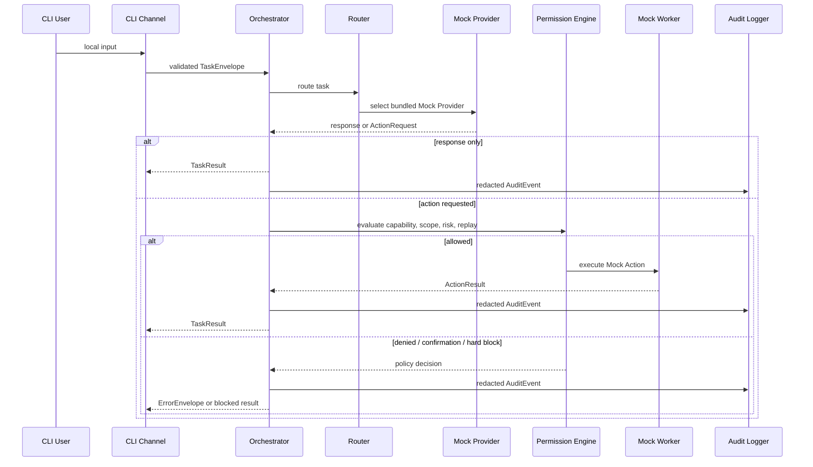

# Architecture

PAIOS CE is a small public-core scaffold built around explicit boundaries.
The architecture deliberately separates data contracts, policy decisions,
execution adapters, and audit evidence.

## Current request flow

## Layers

### Configuration

The configuration layer separates:

- public project configuration;
- private local configuration;
- process environment values;
- CLI overrides; and
- built-in safe defaults.

The resolved runtime configuration is typed and redacted before display.

### Secret references

`SecretRef` represents where a secret may be resolved without placing the raw
secret into public configuration or protocol payloads.

Current public implementations:

- `EnvSecretRef`
- `InMemorySecretRef`

The public release does not ship a production secret backend.

### Protocols

The protocol package defines the public contracts between components:

- `TaskEnvelope`
- `ActionRequest`
- `ApprovalRequest`
- `ActionResult`
- `TaskResult`
- `ErrorEnvelope`
- `AuditEvent`

The models reject unexpected fields. JSON Schemas are generated into
[`../schemas/`](../schemas/).

### Permission and risk engine

The permission layer evaluates:

- declared action identity;
- caller and owner constraints;
- worker capabilities;
- filesystem and network scope;
- risk level;
- explicit-confirmation requirements;
- idempotency; and
- replay detection.

Unknown, critical, administrator, and arbitrary-shell operations fail closed in
the current release candidate.

### Provider and router

The router selects only the bundled Mock Provider. The Mock Provider is:

- local;
- deterministic;
- network-free;
- API-key-free; and
- suitable for repeatable tests and demos.

Provider skeletons are extension boundaries, not supported live integrations.

### Worker

The current worker is a Mock Worker. It exists to test action contracts and
permission decisions without granting real system capabilities.

### Audit and diagnostics

Audit events and diagnostics are designed to avoid:

- raw secret values;
- full process environments;
- private local paths;
- production payloads; and
- unbounded exception content.

## Adapter rule

A future adapter should not be merged merely because it can call an external
service. It must preserve:

1. typed input and output contracts;
2. `SecretRef` handling;
3. deny-by-default permissions;
4. explicit scope and risk classification;
5. redacted audit events;
6. failure and rollback behavior; and
7. clean-machine acceptance evidence.

## Current non-goals

The release candidate does not provide:

- a production personal assistant;
- a live provider marketplace;
- a messaging gateway;
- a speech pipeline;
- browser automation;
- shell or administrator execution;
- remote workers; or
- a production state store.

See [`../SUPPORT_MATRIX.md`](../SUPPORT_MATRIX.md) and
[`../PUBLIC_RELEASE_BOUNDARY.md`](../PUBLIC_RELEASE_BOUNDARY.md).
