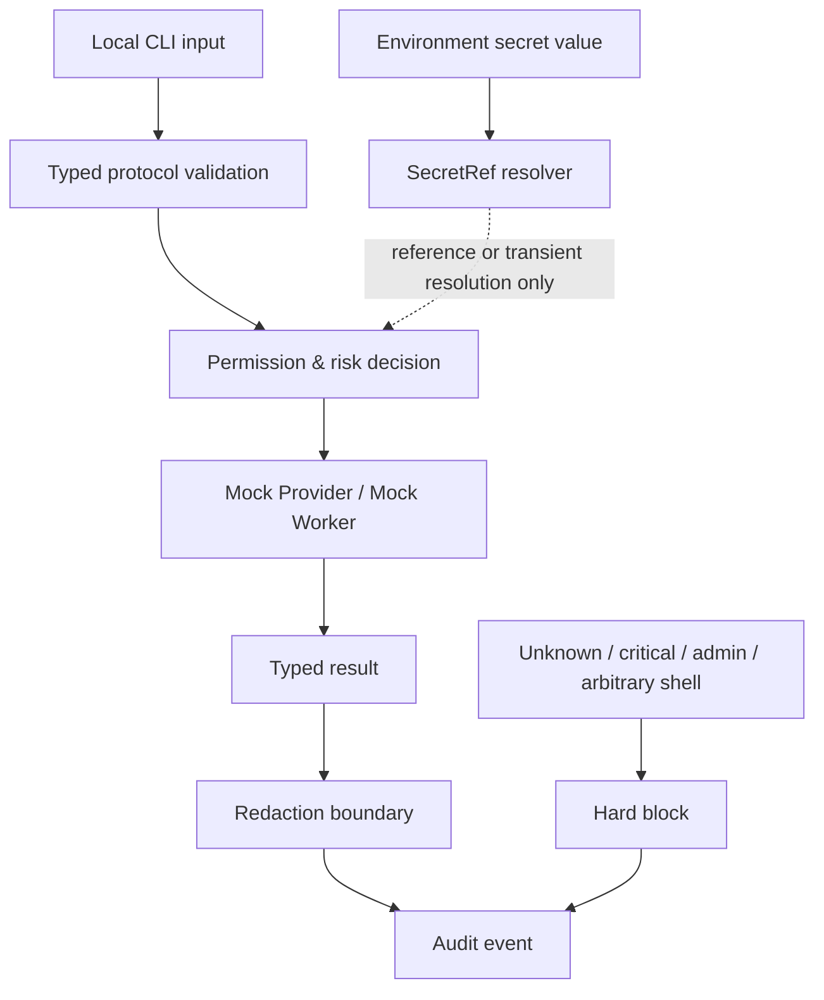

# Security Model

This document explains the security assumptions of the PAIOS CE public release
candidate. It complements, but does not replace, [`../SECURITY.md`](../SECURITY.md).

## Security objective

The public core is designed to make privilege, scope, credential handling, and
audit behavior explicit before live integrations are introduced.

It does not claim to make an arbitrary agent safe. It provides boundaries that
future adapters must preserve and test.

## Trust boundaries

## Frozen defaults

- loopback listeners only;
- public binding disabled;
- direct-message mode and group execution disabled by default;
- owner allowlist required for owner-only actions;
- workers start with zero capabilities;
- high-risk actions require confirmation;
- critical actions are hard-blocked;
- arbitrary shell and administrator elevation are hard-blocked;
- raw audio storage is disabled;
- cloud ASR is opt-in only;
- the bundled Mock Provider performs no network access.

## Credential boundary

Secret values must not be stored in:

- public configuration;
- task or action models;
- logs;
- exception messages;
- audit events;
- examples;
- test fixtures; or
- public evidence.

Only a redacted secret reference may be recorded.

## Threats addressed by the public core

The current controls are intended to reduce:

- accidental secret serialization;
- silent capability expansion;
- unscoped file or network access;
- replay of non-idempotent actions;
- execution of unknown actions;
- leakage through audit and diagnostics;
- confusion between a scaffold and a supported production integration.

## Threats not solved by this candidate

The public core does not claim to solve:

- malicious operating-system administrators;
- compromised Python runtimes;
- malicious future provider adapters;
- supply-chain compromise outside the audited dependency set;
- social engineering;
- prompt injection in unimplemented live channels;
- production multi-user isolation;
- production network perimeter security;
- hardware-backed key protection.

## Reporting a vulnerability

Do not disclose security vulnerabilities in a public Issue. Use GitHub private
vulnerability reporting or Security Advisories, following
[`../SECURITY.md`](../SECURITY.md).

## Adding a live adapter

A live adapter requires a design and acceptance review covering:

1. credentials and rotation;
2. network destinations;
3. capability and scope declarations;
4. confirmation behavior;
5. timeouts and retries;
6. idempotency and replay;
7. redaction;
8. failure and rollback;
9. clean-machine tests; and
10. public support-status updates.

Until those gates pass, an adapter remains planned or scaffold-only.
