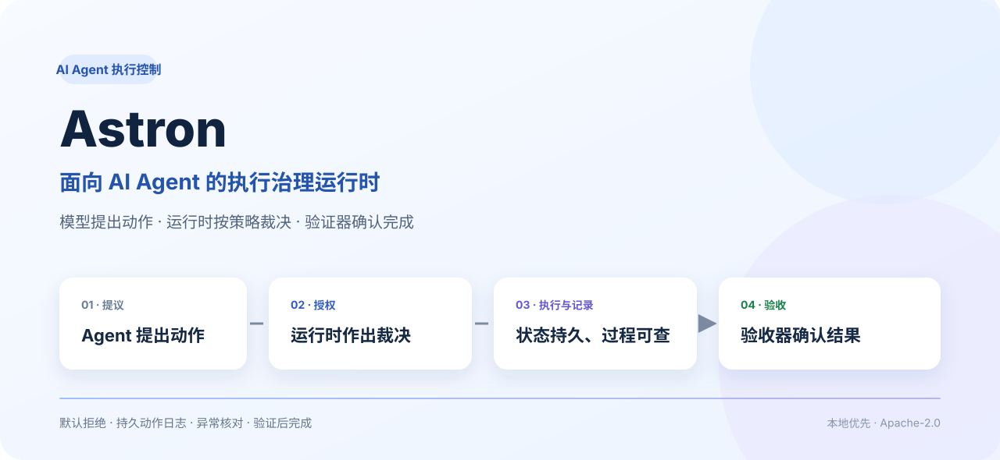
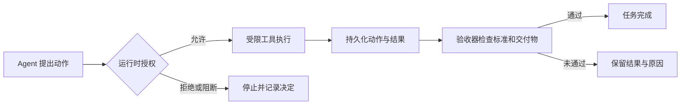
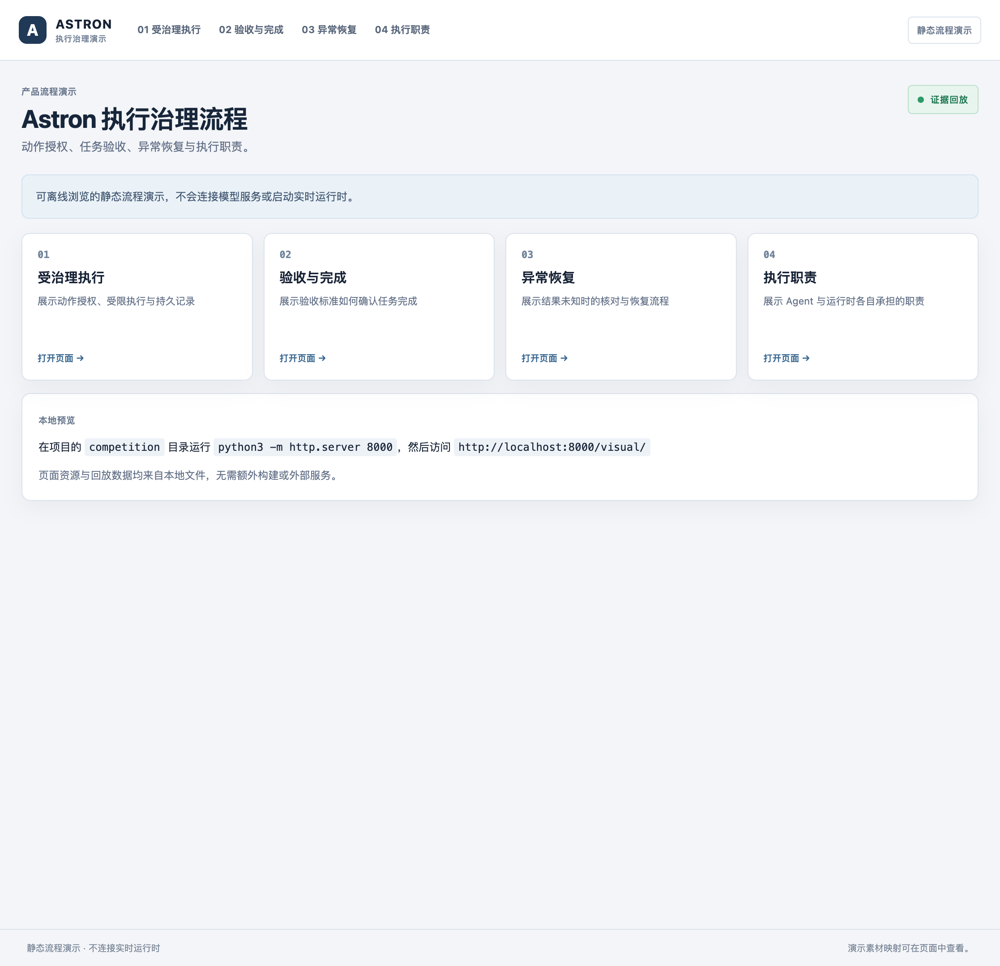
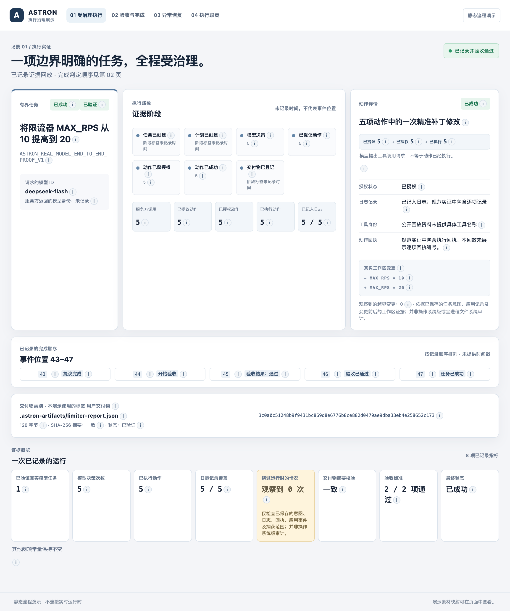
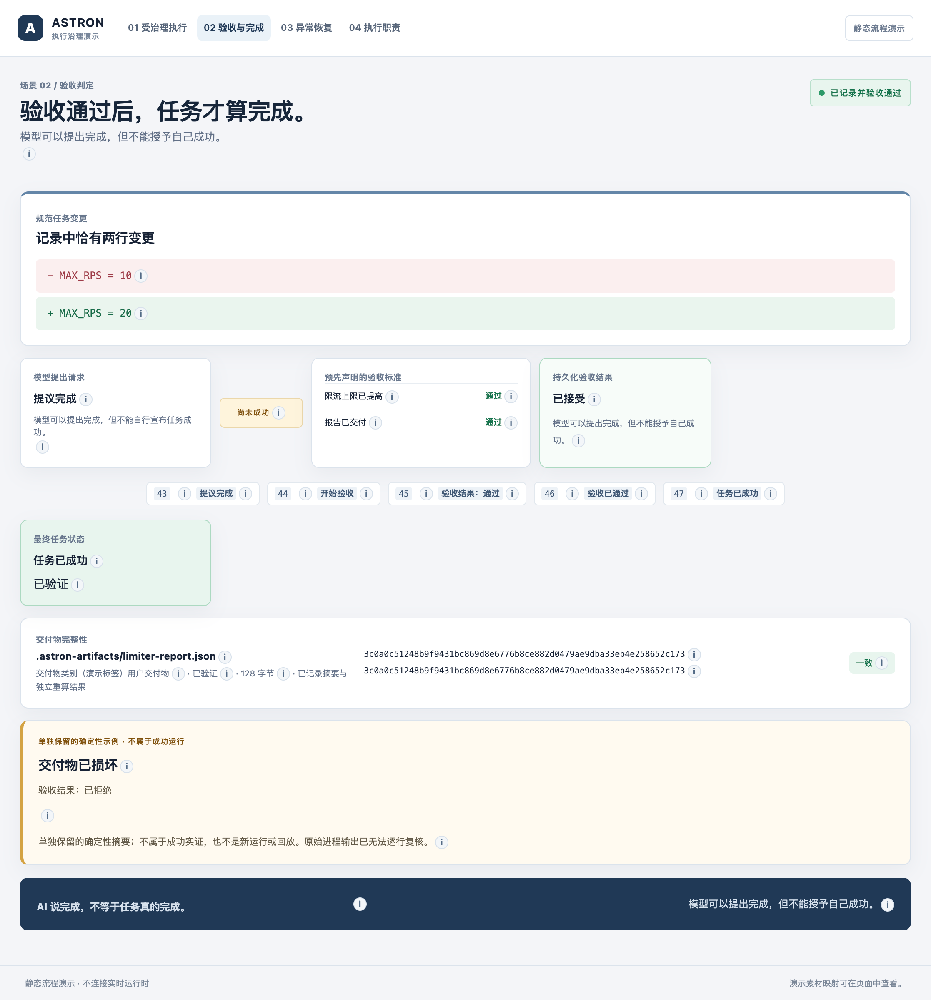
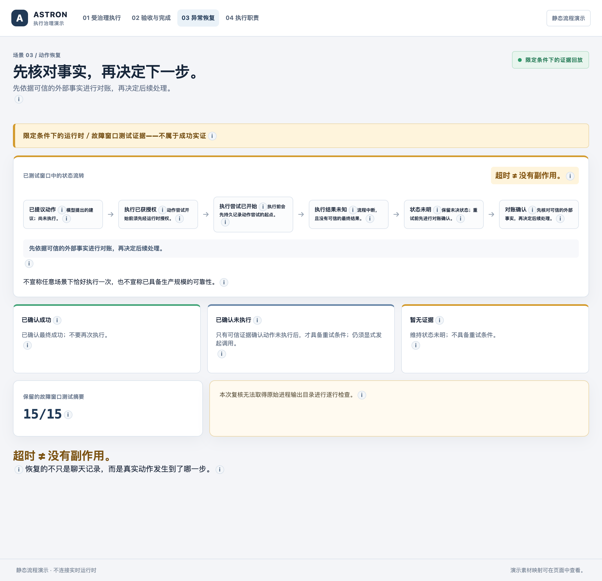
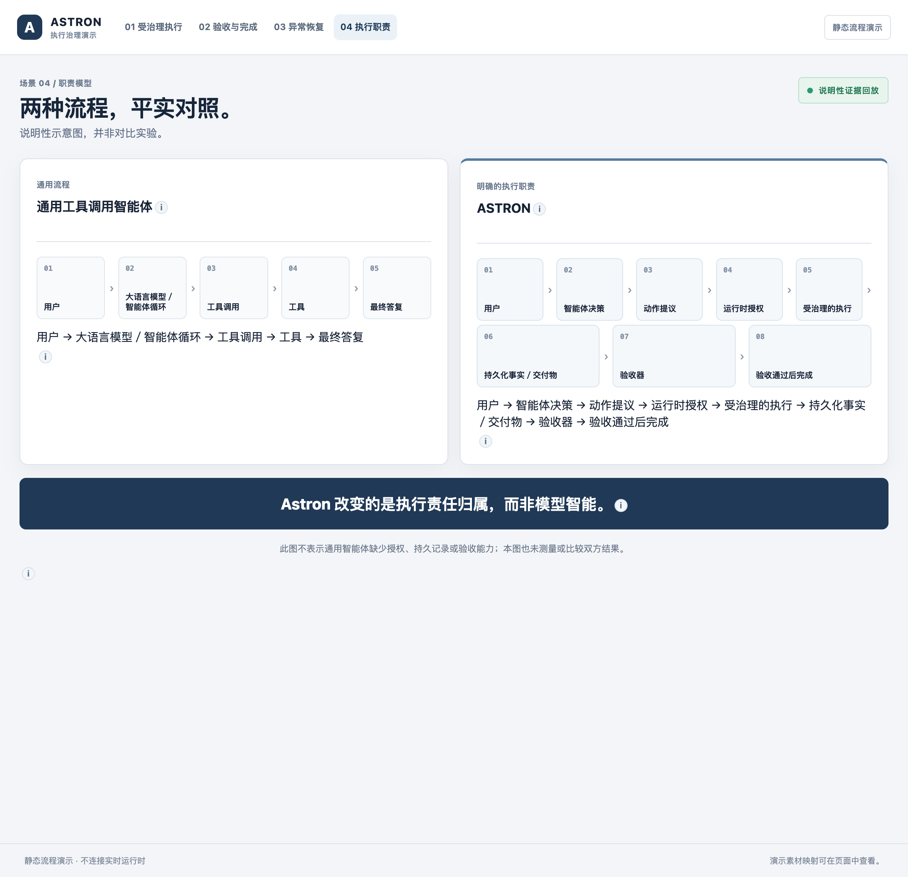

<div align="center">
  
  <h1>Astron</h1>
  <p><strong>让 Agent 的工具执行过程具备明确授权、可追踪状态与验收结果。</strong></p>
  <p>模型提出动作 · 运行时按策略裁决 · 验证器确认任务完成</p>
  <p>
    <a href="competition/visual/">浏览四屏交互演示</a> ·
    <a href="dist/ASTRON_COMPETITION_REVIEW_PACKAGE_V1.zip">下载评审材料 ZIP</a> ·
    <a href="competition/showcase/DEMO_SCRIPT.md">演示讲稿</a> ·
    <a href="source/docs/ARCHITECTURE.md">架构说明</a>
  </p>
</div>

## 项目优势

Astron 把 Agent 的执行控制落到明确的运行时机制中，让工具调用从“模型提出建议”进入可审查、可恢复、可验收的执行流程。

| 优势 | 实现方式 | 带来的价值 |
| --- | --- | --- |
| **动作先授权，再执行** | 默认拒绝；按能力、作用范围与风险策略作出允许、拒绝或阻断决定 | 未知或越界动作不会因为模型提出就直接执行 |
| **执行状态有据可查** | 持久化记录授权、执行尝试、结果与验收事件 | 便于还原动作经过并审查任务状态 |
| **异常后先核对，再继续** | 崩溃后将未确认结果保留为 `UNCERTAIN`，等待可信证据核对 | 避免把“没有收到结果”误当成“动作没有发生” |
| **完成状态由验收器确认** | 对预先声明的标准和交付物进行验证 | 模型的完成声明本身不会代替验收结果 |
| **工具边界清楚** | 文件、测试和终端工具都有作用范围与执行限制 | 将具体能力与允许的操作范围明确关联 |
| **本地即可体验** | 提供无需 API Key 的离线演示，也支持显式配置真实模型服务 | 可以先了解流程，再按项目需求接入模型 |

## 工作流程



## 界面截图

下面的截图展示演示首页和四个中文场景。它们来自随项目提供的离线静态回放，用于说明产品流程；页面不会连接实时模型服务或启动当前运行时。

<p align="center"></p>

<table>
  <tr>
    <td align="center"><br><strong>01 · 受治理执行</strong></td>
    <td align="center"><br><strong>02 · 验收与完成</strong></td>
  </tr>
  <tr>
    <td align="center"><br><strong>03 · 异常恢复与核对</strong></td>
    <td align="center"><br><strong>04 · 执行职责</strong></td>
  </tr>
</table>

## 离线演示

下面的动图展示本地命令行体验：授权范围内的请求可以继续处理；无法识别的动作会被运行时明确阻断。

<table>
  <tr>
    <td align="center"><strong>授权范围内的演示</strong><br></td>
    <td align="center"><strong>未知动作阻断演示</strong><br></td>
  </tr>
</table>

### 打开四屏中文演示

在本目录中运行：

```bash
cd competition
python3 -m http.server 8000
```

然后访问 [http://localhost:8000/visual/](http://localhost:8000/visual/)。演示首页可进入执行、验收、恢复与职责说明四个页面。

### 本地运行产品示例

首次运行前，请按[快速开始](source/docs/QUICKSTART.md)准备 Python 环境。克隆仓库后，在终端运行：

```bash
cd releases/astron-all-products-d32d3ec-r1/source
python3 -m venv .venv
source .venv/bin/activate
python -m pip install -e ".[dev]"
astron health
astron demo
```

还可以运行具体场景：

```bash
bash examples/demos/01_governed_task.sh
bash examples/demos/02_permission_denial.sh
python examples/demos/03_crash_and_reconcile.py
```

### 项目资料

- [快速开始](source/docs/QUICKSTART.md) · [系统架构](source/docs/ARCHITECTURE.md) · [安全模型](source/docs/SECURITY_MODEL.md)
- [核心技术报告](competition/docs/03_TECH_REPORT_CORE.md) · [评审问答](competition/docs/06_JUDGE_QA.md) · [主张与术语说明](competition/docs/07_CLAIM_LANGUAGE_AUTHORITY.md)
- [项目简介](competition/showcase/PROJECT_BRIEF.md) · [答辩提纲](competition/showcase/PRESENTATION_OUTLINE.md) · [四分钟演示讲稿](competition/showcase/DEMO_SCRIPT.md) · [常见问题](competition/showcase/FAQ.md) · [评审 ZIP 首页](competition/showcase/REVIEW_PACKAGE_README.md)
- [演示证据与页面映射](competition/demo_evidence/06_EVIDENCE_TO_SCREEN_MAP.json) · [演示说明](competition/visual/README.md)
- [Apache-2.0 许可证](source/LICENSE)

---

**Astron：让每一次工具动作都有清晰的授权路径、持久记录和明确的验收结果。**
