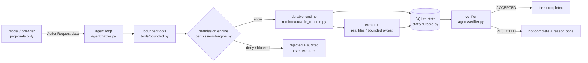

# Astron

**A model may propose. Only the runtime decides whether an action executes, and
only a verifier decides whether a task is complete.**

Astron is an execution-governance runtime that sits between "the model asked for
a tool call" and "something happened in the world". It owns the trusted principal,
the authorization decision, bounded tool execution, durable state, crash
recovery and verified completion.

> Delivery state: source snapshot `d32d3ec` (package version `0.1.0rc2`,
> `Development Status :: 3 - Alpha`), Apache-2.0. Every documented capability
> below runs offline without an API key. The evaluation work (R2/R3) is a
> separate layer, not a feature list — see
> [docs/EVALUATION_SUMMARY.md](docs/EVALUATION_SUMMARY.md).

```text
PRODUCT_SNAPSHOT      = d32d3ec1bc49a78d0b14aabb6bf0daf79d3f4d88   (astron 0.1.0rc2)
R2_EVALUATED_RUNTIME  = 13ee283ce8b6121af14b1bf0f1f9deefe1484cf2   (the runtime that was measured)
```

> Version boundary, honoured throughout the package: the R2 result belongs to the
> `13ee283` measurement and is **not** a direct validation of `d32d3ec`, which
> carries no formal model-run evidence of its own.


## The problem it actually removes

Once a model is allowed to touch tools, the recurring failures are rarely
"the model was not smart enough". They are:

1. the model reports success while the file was never changed, or changed in the
   wrong place;
2. a permitted tool list still lets the model name a shell command, an upload, or
   an action that does not exist;
3. a process dies halfway through an external effect, and the restart has no
   evidence, so the retry duplicates it;
4. permissions, path limits and budgets live in prompt text, which means they
   exist nowhere.

Astron moves those four things out of the prompt and into code: model output is
data, and a real permission engine, a real SQLite state authority and a real
deterministic verifier decide what happens.

## Capabilities present in this snapshot

| Capability | Mechanism | What it looks like in practice |
| --- | --- | --- |
| Deny-by-default authorization | `PermissionEngine` + risk policy: unknown actions, arbitrary shell, elevation, CRITICAL, financial and identity actions are hard-blocked | a `system.shell.exec` proposal returns `blocked` with `execution_attempted: false` |
| Trusted principal + replay identity | the payload carries no authority; `idempotency key + principal + request fingerprint + security-context fingerprint` decide whether an authorization may be reused | another principal reusing the key gets `E_IDEMPOTENCY_KEY_REUSE_MISMATCH` |
| Durable action lifecycle | SQLite schema v2: authorization records, runtime tasks, action journal, append-only events, checkpoints, reconciliation events, verification results (WAL, `synchronous=FULL`, owner-private file hardening) | after a crash, a journal row says `ATTEMPT_STARTED` with no terminal state |
| Uncertain actions and reconciliation | `recover_task` only classifies; `UNCERTAIN` never auto-retries; only a trusted `Reconciler` observing real evidence may settle it | confirm from a ledger, do not "run it again and see" |
| Bounded tool surface | seven named workspace/validation/test tools plus six governed `terminal_*` sessions, with path, symlink, byte, output and turn caps | repository maintenance: read → exact patch → bounded pytest → artifact |
| Verified completion | `MaintenanceVerifier` is the sole completion authority: structural checks, forbidden mutations, bounded tests, artifact contract. Action `SUCCEEDED` ≠ task complete | model text `done` maps to `AGENT_STOPPED`; only `VERIFIER_ACCEPTED` completes |
| Offline, demonstrable loop | Mock Provider runs the whole governed chain; the OpenAI-compatible adapter is opt-in and proposes only | key-free demos plus a real model behind explicit flags |

## Shape of a run



Normal chain: register task → proposal → normalization and validation →
authorize → `AUTHORIZED` → `ATTEMPT_STARTED` → execute → `SUCCEEDED` / `FAILED` /
`UNCERTAIN` → once the loop ends, the verifier decides. See
[docs/ARCHITECTURE.md](docs/ARCHITECTURE.md) for the failure branches.

## Fastest working path

```bash
python3 -m venv .venv && source .venv/bin/activate
python -m pip install -e ".[dev]"

astron health
astron demo
astron run-task examples/unknown_action_fixture.json   # explicit reject, exit code 5
```

The offline demos need no key and no network, and write only into a fresh
`mktemp -d`:

```bash
bash examples/demos/01_governed_task.sh
bash examples/demos/02_permission_denial.sh
python examples/demos/03_crash_and_reconcile.py
```

A live model is opt-in: you pass the endpoint, the model id and the **name** of
the environment variable holding the key. Astron never takes the secret itself,
and never falls back to Mock to fake a success.

```bash
export MY_PROVIDER_KEY=...
astron maintenance-demo --mode live \
  --base-url https://api.example.com/v1 --model <model-id> --api-key-env MY_PROVIDER_KEY \
  --workspace "$(mktemp -d)/workspace" --state-db "$(mktemp -d)/state.sqlite"
```

## Single and Team

* **Single** is the main line: everything above, reachable from the `astron` CLI
  and installed by the wheel.
* **Team** (`team/`) is optional and experimental: a Supervisor → Executor →
  Auditor → Verifier hand-off that reuses the same permission engine, the same
  durable store and the same verifier, narrowing *which role may propose which
  tool*. It has no CLI entry point, is not included in the wheel
  (`pyproject.toml` packs `src/` only), and its default executor-round budget
  is 1. Try it offline with
  `PYTHONPATH=src:. python examples/demos/04_team_offline_run.py`. It is not
  presented as "better than Single"; the reasons are in
  [docs/SECURITY_AND_LIMITATIONS.md](docs/SECURITY_AND_LIMITATIONS.md).

## Layout

```text
src/paios_ce/        product package (agent, permissions, state, runtime, tools, providers, cli, …)
team/                experimental Team roles and role-scoped tool authority (not packaged, not on the CLI)
examples/            config templates, protocol fixtures, demos/
schemas/             JSON Schemas for the public protocol models
tests/               546 offline tests, including real cross-process crash recovery
docs/                architecture, source map, configuration, development, operations,
                     security & limitations, evaluation summary
.github/             CI workflows and issue/PR templates
```

## Reading list

[PROJECT_OVERVIEW](docs/PROJECT_OVERVIEW.md) ·
[QUICKSTART](docs/QUICKSTART.md) ·
[ARCHITECTURE](docs/ARCHITECTURE.md) ·
[SOURCE_MAP](docs/SOURCE_MAP.md) ·
[CONFIGURATION](docs/CONFIGURATION.md) ·
[DEVELOPER_GUIDE](docs/DEVELOPER_GUIDE.md) ·
[OPERATIONS](docs/OPERATIONS.md) ·
[SECURITY_MODEL](docs/SECURITY_MODEL.md) ·
[SECURITY_AND_LIMITATIONS](docs/SECURITY_AND_LIMITATIONS.md) ·
[EVALUATION_SUMMARY](docs/EVALUATION_SUMMARY.md) ·
[docs/INDEX.md](docs/INDEX.md)

## Requirements

* Python `>=3.11`. Upstream `SUPPORT_MATRIX.md` records its own validation base
  as macOS + CPython 3.12; this delivery copy was re-checked on macOS/arm64 with
  CPython 3.13 (`546 passed, 1 skipped`).
* Runtime dependencies are only `pydantic`, `PyYAML`, `jsonschema` and `pytest`
  (`pytest` is a runtime dependency of the bounded test tool, not an extra).
* Core and demos run on macOS/Linux. Private-state hardening has a real Windows
  ACL backend; `terminal_*` requires a POSIX pty and is not implemented on
  Windows.
* Optional local speech needs `.[speech]` (faster-whisper) and is disabled by
  default.

## License and provenance

Apache-2.0. Copyright is held as recorded in `NOTICE` (`PAIOS CE`,
`Copyright 2026 Cheng Cheng`). Astron is the competition identity of the same
codebase; `paios_ce` remains the import path and historical package name, and
was deliberately not renamed. Upstream:
`https://github.com/chengcheng-2006/paios-ce`. This package is a delivery
assembly: nothing was pushed, tagged, or published, and it is not a new official
release.
