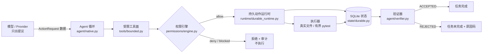

# Astron

**模型提议，运行时裁决，验证器验收。**
**The model proposes. The runtime decides. The verifier accepts.**

Astron 是一个 Agent **执行治理运行时**：它位于“模型提出动作”与“外部世界产生后果”之间，
负责主体身份、权限判定、受限工具执行、持久状态、崩溃恢复与验证后完成。
模型的输出只是数据；它不能选择自己的身份、不能给自己授权、不能直接执行工具、也不能宣布任务完成。

```text
PRODUCT_SNAPSHOT      = d32d3ec1bc49a78d0b14aabb6bf0daf79d3f4d88   (astron 0.1.0rc2)
R2_EVALUATED_RUNTIME  = 13ee283ce8b6121af14b1bf0f1f9deefe1484cf2   (被评测的那个 runtime)
LICENSE               = Apache-2.0 · 交付形态：源码快照，非官方 release
```

> 版本边界（全项目一致遵守）：R2 的 120 次运行结果属于 `13ee283` 这次测量，
> **不是**对本交付快照 `d32d3ec` 的直接验证；`d32d3ec` 自身不携带任何正式模型运行证据。
> 详见 [docs/EVALUATION_SUMMARY.md](docs/EVALUATION_SUMMARY.md)
> 与 [docs/competition/DEFENSE_QA.md](docs/competition/DEFENSE_QA.md)。

## 架构



一次正常任务：注册 → 提议 → 归一化与校验 → 授权 → 落 `AUTHORIZED` → 落 `ATTEMPT_STARTED`
→ 执行 → 落 `SUCCEEDED`/`FAILED`/`UNCERTAIN` → 循环结束后必定调用验证器 → 只有 `ACCEPTED`
使任务完成。完整调用链与动作生命周期见 [docs/ARCHITECTURE.md](docs/ARCHITECTURE.md)。

## 3 分钟 Quick Start（无需 API Key、无需网络）

```bash
cd project && python3 -m venv .venv && source .venv/bin/activate
python -m pip install -e ".[dev]"

astron health            # 本地组件自检
astron demo              # Mock Provider 闭环
astron run-task examples/unknown_action_fixture.json; echo "exit=$?"
```

最后一条命令就是你 30 秒能看到的第一个治理结果：

```text
"action_class": "UNKNOWN_ACTION",  "error_code": "E_UNKNOWN_ACTION",
"decision": "blocked",             "execution_attempted": false      exit=5
```

模型编造了一个不存在的动作名。运行时在任何能力检查、审批检查之前显式拒绝它，
并且**没有执行任何东西**。稳定退出码：`0` 成功 `2` 用法 `3` 配置 `4` 拒绝 `5` 阻断 `6` 内部错误。

## 核心能力摘要

* **默认拒绝的权限引擎** — 未知动作、任意 shell、提权、CRITICAL、金融、身份类硬阻断；
  风险策略表 + 能力白名单 + 作用域类比对。
* **可信主体与幂等身份** — `idempotency key + principal + 请求指纹 + 安全上下文指纹`
  共同决定一次授权能否复用；换主体重用同一 key 直接阻断。
* **持久动作生命周期** — SQLite schema v2（WAL + `synchronous=FULL` + 文件 owner-private）：
  授权记录、动作日志、只追加事件、检查点、核对事件、验证结论。
* **不确定状态与核对** — 崩溃后 `recover_task` 只做分类；`UNCERTAIN` **永不自动重试**；
  只有可信 `Reconciler` 读到真实证据后才能落终态。
* **受限工具面** — 7 个具名工作区/校验/有界测试工具 + 6 个受治理终端会话；
  路径、符号链接、字节、输出、轮次全部有界。
* **验证后完成** — `MaintenanceVerifier` 是唯一完成权威：结构检查 + 禁止改动 + 有界测试 +
  完成产物契约；模型自述 `done` 只映射为 `AGENT_STOPPED`。
* **可选真实模型** — OpenAI 兼容 Provider 显式开启、只发提议、密钥只以环境变量名传入，
  失败不回落到 Mock 假装成功。

## Demo 入口

| 入口 | 命令 | 展示 |
| --- | --- | --- |
| 90 秒演示（答辩用） | [docs/competition/DEMO_SCRIPT_90S.md](docs/competition/DEMO_SCRIPT_90S.md) | 提议 → 治理 → 执行 → 持久记录 → 验证器验收 |
| 完整演示讲稿 | [../showcase/DEMO_SCRIPT.md](../showcase/DEMO_SCRIPT.md) | 4 分钟版，含失败处置 |
| 一次受治理任务 | `bash examples/demos/01_governed_task.sh` | 基线失败认证 → `VERIFIER_ACCEPTED` |
| 权限拒绝 | `bash examples/demos/02_permission_denial.sh` | allow / deny / hard-block，全部 `execution_attempted=false` |
| 崩溃与核对 | `python examples/demos/03_crash_and_reconcile.py` | 真实进程中途被杀 → `UNCERTAIN` → 核对落终态 |
| Team（实验性） | `PYTHONPATH=src:. python examples/demos/04_team_offline_run.py` | 角色化权限的一轮受治理交接 |

全部离线演示：无 Key、无网络、产物只落在 `mktemp -d`。说明见
[examples/demos/README.md](examples/demos/README.md)。

## Current Scope & Engineering Boundaries

**在本快照中已实现且可复跑**：上述七项核心能力 + `RepoTaskRunner`（通用受治理仓库任务：
干净 checkout 强制、独立预算、diff/轨迹捕获）+ 脱敏审计 + 公私有配置优先级 + 可选本地 ASR。

**明确不在当前范围内**（不要当作已交付能力宣传）：

* 通用仓库验证器。打包的验证器只对**一个固定 fixture** 成立，这是产品当前最大的真实空白。
* 操作系统级隔离。有界 pytest 是真实子进程，`terminal_*` 是真实 `/bin/zsh` 会话（POSIX only）；
  “受限”不等于“只读”，更不等于沙箱。
* 回滚/补偿。`rollback_supported` 对所有已发布操作恒为 `False`。
* `UNCERTAIN` 的自动处理。它设计上就会停住，等待人工或专用核对器。
* 服务化组件：无调度器、无队列、无指标、无告警、无常驻审计 sink（默认写内存流）。
* 团队化外围：Live Channel（PLANNED）、麦克风/流式语音、群执行、远程执行、Hermes/OpenClaw 集成。
* Team 形态：`team/` 不在 wheel 内、无 CLI 入口、默认执行轮次预算 1、含一处已知死代码缺陷；
  它是**更窄的权限模型**，不是“更强的模式”。
* 平台：核心 macOS/Linux；Windows 有真实状态文件 ACL 后端，但当前改件的 Windows/Ubuntu
  运行时上游记录为 `NOT_RUN`。
* 全部限制清单：[docs/SECURITY_AND_LIMITATIONS.md](docs/SECURITY_AND_LIMITATIONS.md)。

## Research Evidence

研究评测是**支撑材料**，不是产品叙事主线，也不是能力清单：

* [docs/EVALUATION_SUMMARY.md](docs/EVALUATION_SUMMARY.md) — R2 的 120 次正式运行
  （40 Direct / 40 Single / 40 Team，`13ee283`，DeepSeek `deepseek-v4-flash`）：
  能力子集 `0/72` 是三臂同为 0 的地板效应，23 次 provider 错误造成臂间差异删失。
  **结论：未建立 Astron 提高成功率或更安全。**
* R3 仍在开发集校准阶段，**没有 final holdout 结论**；Generic/Direct 的校准成绩不是 Astron 成绩。
* 证据边界与不可得结论的完整列表在上面的 EVALUATION_SUMMARY；评委问答见
  [docs/competition/DEFENSE_QA.md](docs/competition/DEFENSE_QA.md)、一页版见
  [docs/competition/ONE_PAGE_PROJECT_BRIEF.md](docs/competition/ONE_PAGE_PROJECT_BRIEF.md)。

## 更多入口

| 你要做什么 | 去哪里 |
| --- | --- |
| 5 分钟理解项目 | [../START_HERE.md](../START_HERE.md) → 本文件 |
| 给评委/合作方介绍 | [docs/competition/ONE_PAGE_PROJECT_BRIEF.md](docs/competition/ONE_PAGE_PROJECT_BRIEF.md)、[docs/PROJECT_OVERVIEW.md](docs/PROJECT_OVERVIEW.md) |
| 3 分钟路演 | [docs/competition/PITCH_3MIN.md](docs/competition/PITCH_3MIN.md) |
| 答辩问答 | [docs/competition/DEFENSE_QA.md](docs/competition/DEFENSE_QA.md) |
| 接手开发 | [../handoff/ASTRON_PROJECT_CONTEXT.md](../handoff/ASTRON_PROJECT_CONTEXT.md) → [docs/SOURCE_MAP.md](docs/SOURCE_MAP.md) → [docs/DEVELOPER_GUIDE.md](docs/DEVELOPER_GUIDE.md) |
| 安装/配置/运维 | [docs/QUICKSTART.md](docs/QUICKSTART.md) · [docs/CONFIGURATION.md](docs/CONFIGURATION.md) · [docs/OPERATIONS.md](docs/OPERATIONS.md) |
| 设计与契约 | [docs/ARCHITECTURE.md](docs/ARCHITECTURE.md) · [docs/SECURITY_MODEL.md](docs/SECURITY_MODEL.md) · [docs/INDEX.md](docs/INDEX.md) |

```text
src/paios_ce/   产品核心（agent / permissions / state / runtime / tools / providers / cli …）
team/           实验性 Team 角色层（未打包、未接 CLI）
examples/       配置模板、协议 fixture、demos/ 离线演示
tests/          546 项离线测试（含真实跨进程崩溃恢复）
docs/           技术文档 + docs/competition/ 展示层
```

要求：Python `>=3.11`；依赖仅 `pydantic`、`PyYAML`、`jsonschema`、`pytest`
（`pytest` 是有界测试工具的运行时依赖）。许可证 Apache-2.0，版权见 `NOTICE`
（`PAIOS CE`, `Copyright 2026 Cheng Cheng`）。`paios_ce` 是延续的历史包名，未做全局改名。
本包为交付整理：未推送、未打标签、未发布，也不是新的官方版本。
