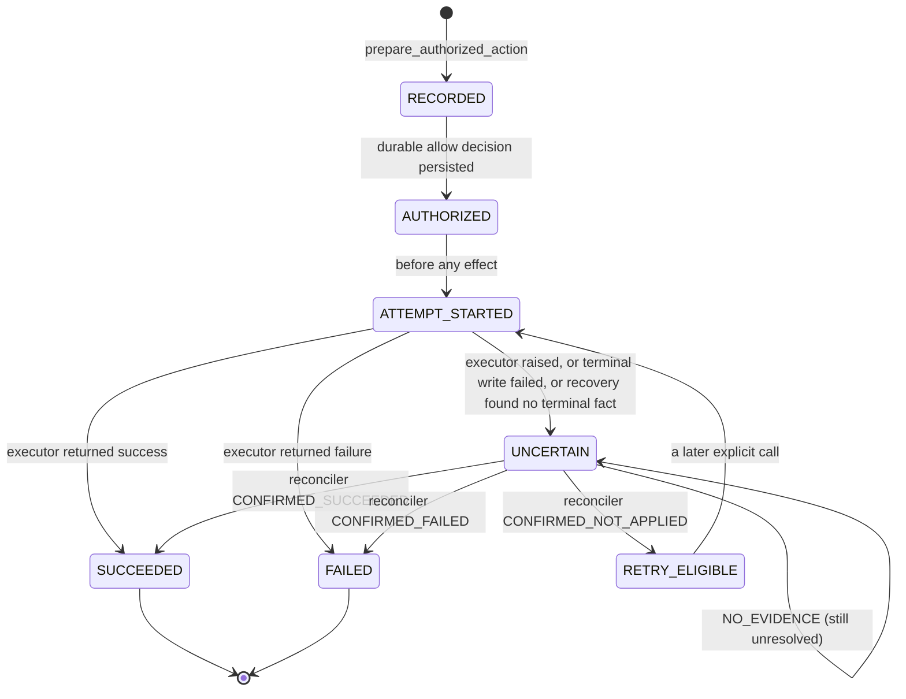
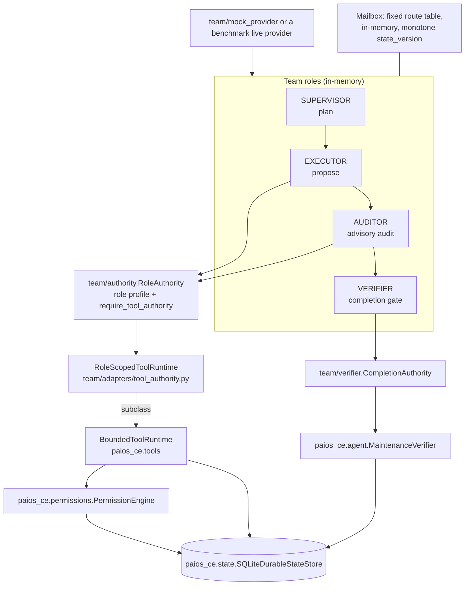

# Astron architecture

Astron is an execution-governance runtime placed between an Agent proposal and
an accepted external outcome. The Agent can suggest what should happen; the
trusted runtime owns identity, authorization, durable execution facts, bounded
tool invocation, recovery, and final verification.

```text
User / Task
    |
    v
LLM / Agent  (proposal source only)
    |
    | untrusted ActionRequest data
    v
+---------------------------------------------------------------+
| Astron Runtime                                                |
|                                                               |
| Trusted Principal Context --> Permission Engine               |
|           |                    |                              |
|           `--> canonical identity / idempotency replay        |
|                                |                              |
|                         Durable SQLite Store                  |
|                         |-- Action Journal                    |
|                         |-- Action Events                     |
|                         |-- Checkpoints                       |
|                         |-- Reconciliation Events             |
|                         `-- Verification Events               |
|                                |                              |
|                         Bounded Tool Registry                 |
|                                |                              |
|                         Deterministic Verifier                |
+---------------------------------------------------------------+
                                  |
                                  v
                         Verified Completion
```

## Trust boundary

The model-facing `ActionRequest` is data, not authority. The runtime supplies a
separate trusted `PrincipalContext`, derives canonical request and current
security-context fingerprints, and asks the Permission Engine to evaluate the
complete identity. The model cannot select its principal, grant itself a
capability, reinterpret a blocked decision, invoke a tool directly, reconcile an
uncertain action, or write `TASK_COMPLETED`.

Concretely: `BoundedToolRuntime` constructs the `ActionRequest` itself from a
normalized proposal
(`src/paios_ce/tools/bounded.py:170-199`) and executes it under
`PrincipalContext(principal_id=BoundedToolRuntime.PRINCIPAL_ID)`
(`src/paios_ce/tools/bounded.py:128-147`). The model never supplies
`filesystem_scope`, `network_scope`, `required_permissions`, `idempotency_key` or
the principal — the tool registry derives them per operation
(`_scope_for`, `_CAPABILITIES`).

## Call chain, in order

| Step | Code | What it may and may not decide |
| --- | --- | --- |
| Entry | `cli/main.py:_cmd_maintenance_demo` | chooses provider, builds fixture + store + tool runtimes; live mode requires explicit endpoint/model/credential-name |
| Loop | `agent/native.py:NativeAgent.run` | asks the provider for a proposal; classifies the batch; never touches the filesystem itself |
| Proposal | `providers/openai_compatible.py:tool_call` / `providers/mock.py` | returns tool calls as data; cannot execute |
| Normalize | `tools/bounded.py:_build_request`, `_normalize_parameters`, `_safe_path` | allowlists the operation, the parameter names, the relative POSIX path, symlink ancestors, byte bounds |
| Authorize | `permissions/engine.py:PermissionEngine.authorize` → `_evaluate` → `_hard_block_reason` → `_check_replay` | capability, scope, owner rule, high-risk confirmation, hard blocks, durable replay identity |
| Persist intent | `state/durable.py:prepare_authorized_action` → `record_attempt_started` | writes `AUTHORIZED` then `ATTEMPT_STARTED` before any effect |
| Execute | `runtime/durable_runtime.py:DurableActionRuntime.execute` → `tools/bounded.py:_execute_request` | the only place a real effect happens; an exception after the boundary marks `UNCERTAIN` |
| Persist outcome | `state/durable.py:record_terminal` / `mark_uncertain` | `SUCCEEDED` / `FAILED` / `UNCERTAIN`, plus an append-only event and a checkpoint |
| Verify | `agent/verifier.py:MaintenanceVerifier.verify` | structural checks, forbidden mutations, bounded pytest, artifact contract; sole completion authority |
| Record | `state/durable.py:record_task_verification` | `ACCEPTED` / `REJECTED` + reason code becomes the durable task fact |

## Action lifecycle



The ordered durable boundary is:

```text
authorize and persist decision
-> create journal and checkpoint
-> persist ATTEMPT_STARTED
-> invoke trusted bounded executor
-> persist SUCCEEDED, FAILED, or UNCERTAIN
-> return
```

`AUTHORIZED`/`RETRY_ELIGIBLE` are the only states `DurableActionRuntime.execute`
will run from. A pre-existing `UNCERTAIN` or terminal record returns without
invoking the executor (`runtime/durable_runtime.py:102-112`).

## Three different things, and why they are not one word

Reviewers often collapse these into "replay". They are separate operations with
separate authorities:

| Operation | Code | Touches the external world? | May change state? |
| --- | --- | --- | --- |
| **Rebuild state** — read what actually happened after a restart | `state/durable.py:recover_task`, `journal_events`, `checkpoint`; `runtime/durable_runtime.py:recover_task` | no | only classifies; it does move `ATTEMPT_STARTED` → `UNCERTAIN` because an attempt without a terminal fact cannot be trusted |
| **Re-execute the action** — run the executor again | `DurableActionRuntime.execute` on an `AUTHORIZED`/`RETRY_ELIGIBLE` journal | yes | yes, and only for a state that is legitimately runnable |
| **Confirm the external effect** — decide what an already-uncertain attempt really did | `DurableActionRuntime.reconcile` with a trusted `Reconciler.observe(journal)` | no — it observes existing evidence | yes, it may settle `UNCERTAIN` to `SUCCEEDED`/`FAILED`/`RETRY_ELIGIBLE` |

Authorization-level replay is a fourth, narrower thing: an exact re-presentation
of the same identity (`idempotency key + principal + request fingerprint +
security-context fingerprint`) restores the original decision from
`authorization_replays` without re-deciding it. An identity mismatch is
`E_IDEMPOTENCY_KEY_REUSE_MISMATCH` and blocks. That is replay of a *decision*,
never proof that an action executed.

## Crash recovery

Recovery reads the durable journal rather than inferring from missing process
memory:

```text
no journal                         -> NO_ATTEMPT
AUTHORIZED / RETRY_ELIGIBLE        -> SAFE_TO_CONTINUE (explicit call only)
ATTEMPT_STARTED without terminal   -> UNCERTAIN / NEEDS_RECONCILIATION
SUCCEEDED                          -> TERMINAL_SUCCESS
FAILED                             -> TERMINAL_FAILURE
```

`UNCERTAIN` never triggers blind retry. Only a trusted, action-specific
reconciler may persist `CONFIRMED_SUCCEEDED`, `CONFIRMED_FAILED`,
`CONFIRMED_NOT_APPLIED`, or `NO_EVIDENCE`. Confirmed-not-applied creates
`RETRY_ELIGIBLE`; it still does not execute automatically. More than one
unresolved action in a task raises instead of guessing
(`state/durable.py:recover_task`).

## Bounded tools

The default task path exposes a finite trusted registry instead of arbitrary
process execution:

- `workspace.list_files`, `workspace.read_text` (read-only, batchable);
- `workspace.patch_text` (exact-match single replacement, atomic write);
- `workspace.write_artifact` (one allowlisted artifact directory);
- `validate.json`, `validate.file` (read-only checks, optional trusted schema);
- `test.run_pytest_bounded` (one fixed pytest target, fixed interpreter, bounded
  timeout and output).

Path normalization, symlink escape, size limits, output bounds and durable
action recording are enforced by runtime code. There is no general shell tool in
that registry.

**The one exception in this snapshot, stated plainly.** The Terminal R1
capability (`tools/terminal.py`, added after the R2 measurement commit) attaches
six further operations — `terminal_open`, `terminal_send`, `terminal_read`,
`terminal_signal`, `terminal_close`, `terminal_list` — that drive a **real
persistent shell session** (`/bin/zsh` when present, otherwise `/bin/sh`) through
a POSIX pty. It is governance, not containment: the session is workspace-scoped
by cwd normalization, a regex blocklist rejects administrator/destructive syntax,
network-capable commands are denied unless `allow_network_commands` is set,
output is capped and secret-redacted, every operation is journaled with the
model's logical tool-call id as its replay identity, and child processes are
reaped on shutdown. `TerminalPolicy` says it itself: *"It is intentionally not
described as an OS sandbox."* `TerminalEnabledToolRuntime` only reaches the agent
loop when the caller composes it explicitly
(`agent/native.py:134-138`); the CLI's `maintenance-demo` does.

## Providers

Astron supports a deterministic local Mock Provider and one explicit,
default-off OpenAI-compatible adapter (`urllib`, no SDK). Both are proposal
sources only. The live adapter accepts an endpoint, a model identifier, bounded
request settings and the *name* of an environment credential; it never executes a
returned tool call and never becomes a state or verifier authority.
`providers/skeletons.py` holds unimplemented interface shapes.

> Stale comment warning: `providers/__init__.py` still says the release candidate
> implements "the Mock Provider (P0) only". At this snapshot the
> OpenAI-compatible adapter is real and CLI-reachable. The docstring is upstream
> text kept verbatim; treat `SUPPORT_MATRIX.md` and this document as the
> description of behaviour.

The Agent loop admits zero calls, one bounded call, or a batch of two to four
calls only when every call belongs to the read-only allowlist
(`agent/native.py:23-24, 189-209`). Mixed, unknown, mutating or over-limit
batches are rejected in full before the first call executes.

## Verified completion

The repository-maintenance path uses a trusted typed artifact contract shared by
the Agent-facing instructions and the deterministic verifier
(`maintenance_artifact.py`). The verifier checks the expected source effect,
forbids every other mutation, runs the bounded tests and validates the semantic
completion artifact, then persists an `ACCEPTED`/`REJECTED` record with a reason
code.

```text
action SUCCEEDED != task complete
model says done   != task complete
verifier ACCEPTED -> durable TASK_COMPLETED
```

`RepoTaskRunner` (`agent/repo_task.py`) is the generic single-task variant: it
requires a clean checkout, captures the base commit and final diff, enforces
independent turn/call/wall-clock/output-token budgets, and maps model text such
as `done` only to `AGENT_STOPPED`. It returns no solved verdict — an external
evaluator stays the authority.

## Single and Team

Team is a role layer on top of Single, not a second runtime.



**Shared with Single (same objects, not reimplementations):**
`PermissionEngine`, `ScopeGuard`, `PrincipalContext`
(`team/adapters/tool_authority.py:34-38`), `ActionRequest`/`ActionResult`,
`DurableActionRuntime`, `SQLiteDurableStateStore` (`team/authority.py:19-20`,
`team/lifecycle.py:25-27`, `team/journal.py:24`), the bounded tool implementations
(`RoleScopedToolRuntime` subclasses `BoundedToolRuntime`) and
`MaintenanceVerifier` (`team/verifier.py:22-23`).

**Added by Team:** five role tokens and three role objects
(`team/mailbox.py:15-20`, `team/roles/`), an in-memory FIFO mailbox with a fixed
route table, duplicate-message-id rejection and monotone `state_version`
(`team/mailbox.py:40-48, 189`), a per-run in-memory `TeamState` and a
`TeamActionJournal` projection that asserts every claimed success has a durable
backing row (`team/state.py`, `team/journal.py:161-185`), role-scoped tool
profiles (`team/adapters/tool_authority.py:77-119`), and a completion gate that
refuses any completion request not made by the `VERIFIER` role
(`team/verifier.py:80-85`).

**What Team does *not* add:** no separate provider stack (Team never imports
`paios_ce.providers`), no prompt text in the core roles (they are one-message-in
/ one-message-out contracts delegating to `provider.plan/execute/audit`; prompts
exist only in the benchmark adapter), no durable Team-specific store (the mailbox
and `TeamState` are in memory and die with the run), no resume path
(`TeamScheduler.run` always starts fresh; `ActionLifecycle.recover` is reachable
only from tests), and no `VerifierRole` class. `TeamScheduler.parallel` exists
but is unused.

**Where Team is experimental, in the code's own numbers:** the scheduler's default
`max_executor_rounds` is 1 (`team/scheduler.py:286`) while the module constant
`MAX_EXECUTOR_ROUNDS = 4` is only consumed by the benchmark adapter
(`team/benchmark/adapter.py:179`); `MAX_SUPERVISOR_CALLS` and
`MAX_AUDITOR_CALLS` are never read; the Auditor is advisory
(`team/scheduler.py:543`). `team/feedback.py:37` references names it never
imports, so calling `assert_no_hidden_material` raises `NameError` — it is dead
code, kept as committed.

## Component map

| Concern | Implementation area | Authoritative document |
| --- | --- | --- |
| Trusted identity and replay | `paios_ce.permissions` | [`aic2026/IDEMPOTENCY_SEMANTICS.md`](aic2026/IDEMPOTENCY_SEMANTICS.md) |
| Durable SQLite state | `paios_ce.state` | [`aic2026/DURABLE_RUNTIME.md`](aic2026/DURABLE_RUNTIME.md) |
| Recovery/reconciliation | `paios_ce.runtime` | [`aic2026/RECOVERY_SEMANTICS.md`](aic2026/RECOVERY_SEMANTICS.md) |
| Provider and Agent loop | `paios_ce.agent` | [`aic2026/LIVE_PROVIDER.md`](aic2026/LIVE_PROVIDER.md) |
| Bounded tools | `paios_ce.tools` | [`aic2026/BOUNDED_TOOLS.md`](aic2026/BOUNDED_TOOLS.md) |
| Terminal sessions | `paios_ce.tools.terminal` | [`TERMINAL_CAPABILITY_R1.md`](TERMINAL_CAPABILITY_R1.md) |
| Generic repo task runner | `paios_ce.agent.repo_task` | [`GENERIC_REPO_RUNNER_R1.md`](GENERIC_REPO_RUNNER_R1.md) |
| Completion artifact/verifier | `paios_ce.maintenance_artifact`, `paios_ce.agent.verifier` | [`aic2026/VERIFIED_COMPLETION.md`](aic2026/VERIFIED_COMPLETION.md) |
| Role-scoped authority | `team.authority`, `team.adapters.tool_authority` | this document, section above |

## Non-goals

Astron does not claim a universal exactly-once protocol, an OS sandbox for
arbitrary untrusted code, a general shell, a full workflow framework, a
multi-agent network, or protection from a compromised OS/Python runtime.
External systems still require action-specific idempotency and reconciliation.
